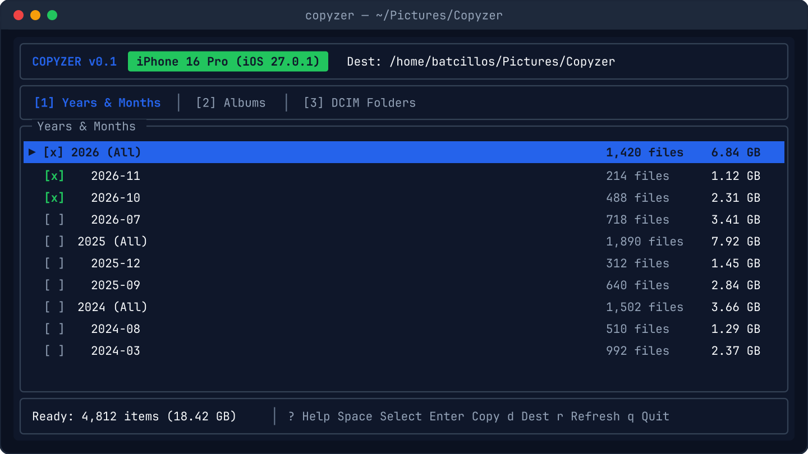
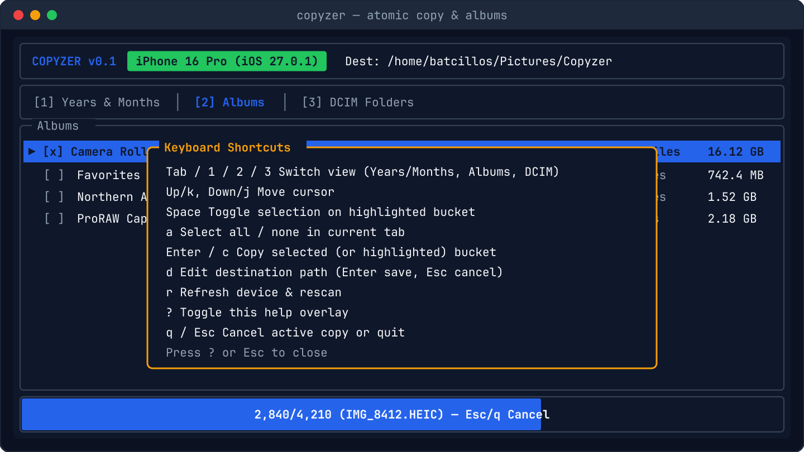

<div align="center">
  
  <h1>Copyzer</h1>
  <p>
    <strong>Fast, keyboard-first iPhone media copier TUI &amp; CLI for Linux.</strong><br />
    <sub>English <em>copy</em> + Pashto <em>zer</em> ("fast") &bull; Built by <a href="https://texodus.tech">Texodus</a></sub>
  </p>

  <p>
    <a href="https://github.com/phaze7r/copyzer/releases/tag/v0.1"></a>
    <a href="LICENSE"></a>
    <a href="https://phaze7r.github.io/copyzer/"></a>
    <a href="https://texodus.tech"></a>
  </p>
</div>

---

**Copyzer** mounts your iPhone over USB-C via `ifuse`, groups photos and videos by **Year & Month**, **Albums**, or raw **`DCIM/` folders**, and copies originals safely to your Linux machine without touching the phone.

## Interface

| Years & Months View | Albums, Help & Live Copy Progress |
| :---: | :---: |
|  |  |

## Features

- **Fast non-blocking `DCIM/` scan** — Walks `DCIM/` using metadata stat calls on a background thread with live progress, keeping the TUI responsive even on 10,000+ item libraries.
- **Year / Month bulk copy** — Groups media by capture year and month (`YYYY-MM`).
- **Best-effort Albums** — Reads `PhotoData/Photos.sqlite` in strict read-only mode when accessible, falling back gracefully to Year/Month and `DCIM/` views.
- **Safe, atomic copies** — Writes to `<filename>.part`, syncs to disk, and renames atomically; skips existing files with matching filename and byte size; preserves timestamps; never mutates iPhone originals.
- **Omarchy live theme** — Reads `~/.local/state/omarchy/current/theme/colors.toml` with a high-contrast slate dark fallback.
- **Clean RAII unmount** — Mounts via `ifuse` and unmounts automatically on exit, error, or cancellation (with lazy-unmount fallback).

## Prerequisites

Install the iOS USB stack (`usbmuxd` starts automatically via udev when you plug in an iPhone):

- **Arch Linux / Omarchy:**
  ```bash
  sudo pacman -S ifuse libimobiledevice usbmuxd
  ```
- **Debian / Ubuntu:**
  ```bash
  sudo apt install ifuse libimobiledevice6 libimobiledevice-utils usbmuxd
  ```
- **Fedora:**
  ```bash
  sudo dnf install ifuse libimobiledevice libimobiledevice-utils usbmuxd
  ```

Plug in your iPhone via USB-C, unlock it, and tap **Trust** if prompted.

## Install

### Option 1: Arch Linux / Omarchy (`PKGBUILD`)

```bash
git clone https://github.com/phaze7r/copyzer.git
cd copyzer/pkgbuild
makepkg -si
```

This installs `/usr/bin/copyzer`, `/usr/share/applications/copyzer.desktop`, and the scalable SVG icon `/usr/share/icons/hicolor/scalable/apps/copyzer.svg` (available in Omarchy's `Super + Space` launcher).

### Option 2: Universal Linux (`install.sh` / Prebuilt Release)

Download and install the `v0.1` release binary + desktop entry:

```bash
curl -fsSL https://raw.githubusercontent.com/phaze7r/copyzer/main/install.sh | bash
```

Pass `--user` (or run without root) to install into `~/.local/bin` instead of `/usr/local/bin`.

### Option 3: Cargo

```bash
cargo install --git https://github.com/phaze7r/copyzer --tag v0.1
```

## Keyboard Shortcuts (TUI)

Launch the TUI by running `copyzer` (or selecting **Copyzer** from your app launcher):

| Key | Action |
| --- | --- |
| `Tab` / `1`–`3` | Switch view (`Years/Months`, `Albums`, `DCIM Folders`) |
| `Up` / `Down` or `j` / `k` | Navigate |
| `Space` | Toggle selection |
| `a` | Select all / none in current view |
| `d` | Edit destination path (default `~/Pictures/Copyzer`) |
| `r` | Refresh device & rescan |
| `Enter` / `c` | Start copy |
| `?` | Toggle help overlay |
| `q` / `Esc` | Cancel active copy or quit and unmount cleanly |

## CLI Usage

```bash
# Launch interactive TUI
copyzer

# Check usbmuxd, ifuse, libimobiledevice, and connected iPhone status
copyzer doctor

# Scan connected iPhone (or local mount) and print JSON
copyzer scan --json

# Copy media headlessly
copyzer copy --year 2026 --month 11
```

## Website & Branding

- **Project Site (GitHub Pages):** [phaze7r.github.io/copyzer](https://phaze7r.github.io/copyzer/) (source in [`docs/`](docs/index.html))
- **Built by:** [Texodus](https://texodus.tech)

## License

[MIT](LICENSE)
